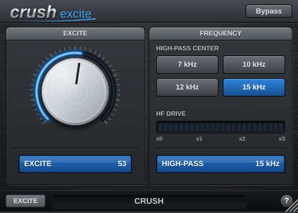

# CRUSH

A one-knob stereo exciter (VST3, Windows x64), built with JUCE 8. Its DSP rebuilds the **Excite**
stage of a legacy multi-effect's distortion section, sample for sample. The GUI and feel follow
Virus Delay: procedurally drawn, with no image assets.



## Controls

| Control | Range | What it does |
|---------|-------|--------------|
| **EXCITE** | 0-100, whole steps | Wet/dry crossfade between the dry signal and the excited signal. 0 = dry, 100 = fully excited |
| **FREQUENCY** | 7 kHz, 10 kHz, 12 kHz, 15 kHz | High-pass corner of the excited band. **7 kHz is the original**; 10, 12 and 15 kHz are Crush extensions that move the band higher |
| **Bypass** | on/off | Host bypass, with a 20 ms crossfade |

* **HF DRIVE** shows the exciter's dynamic gain (full = x3).
* The knob moves in steps of exactly 1.0 when you drag it, and by 1.0 per notch with the mouse wheel.
  Double-click resets it to 50. Hover to see the wet/dry split.
* The window is resizable (70-250 %) from the bottom-right corner and remembers its size.

## How the exciter works (exactly as in the original)

1. Each channel goes through an RBJ high-pass biquad (bandwidth form, BW = 1 octave, f0 = 7 kHz by default).
   The coefficients are designed in double and stored as float. The filter runs in Direct Form I in float.
2. One stereo-linked envelope follower tracks `(hpR + hpL) * 300 * 0.5`. It has a linear 10 ms attack slew
   and a linear 100 ms release.
3. The gain is `min(3, envelope * 10)`. The wet signal is `clamp(hp * gain + x, ±0.999)`.
4. `out = (1 - amount) * x + amount * wet`, then the original's final hard clip at ±0.9999.
5. Processing runs in sub-blocks of at most 64 samples. The amount is latched once per sub-block.

`Source/DSP/DistortionSection.h/.cpp` contains the complete distortion section of the original
(Excite, BitCrusher, Mech and Tube, the 64-sample sub-blocking, the parameter ramps and the
`Original`/`Contiguous` chain orders). It has no framework dependencies. The plugin uses only the
Excite stage. BitCrusher, Mech and Tube stay at 0, which means off, exactly as in the original.

Notes from checking the spec against the decompiled binary:
* In the binary, the stage enable flags (`DistOn > 0.5`, `amount > 0`) are read **once per host block**
  before the sub-block loop, not once per sub-block. The module does the same.
* The envelope steps are computed in float: `1 / (0.01f * fs)` and `1 / (0.1f * fs)`.
* The gain reaches its cap after about **148** samples at 44.1 kHz, not 132. Each sample first decays by
  the release step and then rises by at most the attack step, so the net rise is `attack - release`.
* The exciter's high-pass corner is clamped to 0.45 x the sample rate, so 15 kHz stays valid at low rates.

## Tests and null test

```bash
cmake -B build -DCRUSH_BUILD_PLUGIN=OFF
cmake --build build --config Release
ctest --test-dir build -C Release --output-on-failure
```

* `crush_unit_tests` covers the biquad coefficients at 44.1k/48k, the evaluation order and the denormal
  guard, the envelope step and release, the excite mix and clip, BitCrusher quantisation (default and
  legacy), the Mech and Tube transfer curves, sub-blocking and parameter ramps.
* `crush_nulltest` is the null-test harness:
  * `crush_nulltest --in in.wav --out out.wav --excite 0.5 --ref original.wav` prints the max abs
    difference, the RMS difference in dBFS and the first differing sample.
  * `crush_nulltest --suite outDir --refdir originalRenders [--drums loop.wav]` renders a 1 kHz sine at
    -6 dBFS, a 10 kHz sine at -12 dBFS, pink noise at -12 dBFS, impulses and a drum loop through each stage
    alone at p = 0.25/0.5/0.75/1.0. It compares each render with the file of the same name, for example
    `pink_excite_050.wav`, and flags any error above 1e-6. Render the references from the original with
    the bandpass, filter, flanger, EQ and compressor **OFF**, master mix at 100 % and volume at unity.
  * `crush_nulltest --curves dir` followed by `python tools/plot_curves.py dir` plots the Tube and Mech
    transfer curves and the Excite envelope step response to PNG files.
  * Other options: `--bitcrusher --mech --tube --diston --order original|contiguous --oldcrush --noclip --freq --block`.

## Building

CMake 3.22+ and Visual Studio 2022. JUCE 8.0.4 is downloaded automatically. You can pass
`-DJUCE_DIR=/path/to/JUCE` to use a local checkout instead.

```bash
cmake -B build -A x64
cmake --build build --config Release --target Crush_VST3
```

The plugin is written to `build/Crush_artefacts/Release/VST3/CRUSH.vst3`.

On every push to `main`, GitHub Actions builds the Windows VST3, runs the tests, and publishes
`CRUSH-VST3-Windows-x64.zip` to the **`builds`** branch.

The audio path is compiled with `/fp:precise` on MSVC and `-ffp-contract=off` elsewhere, so there is
no FMA contraction or fast-math, which a bit-exact match needs.
